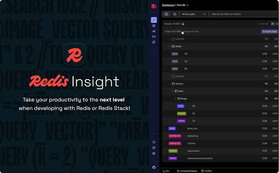
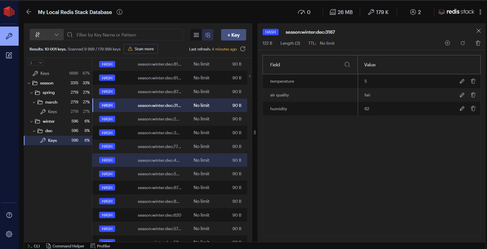
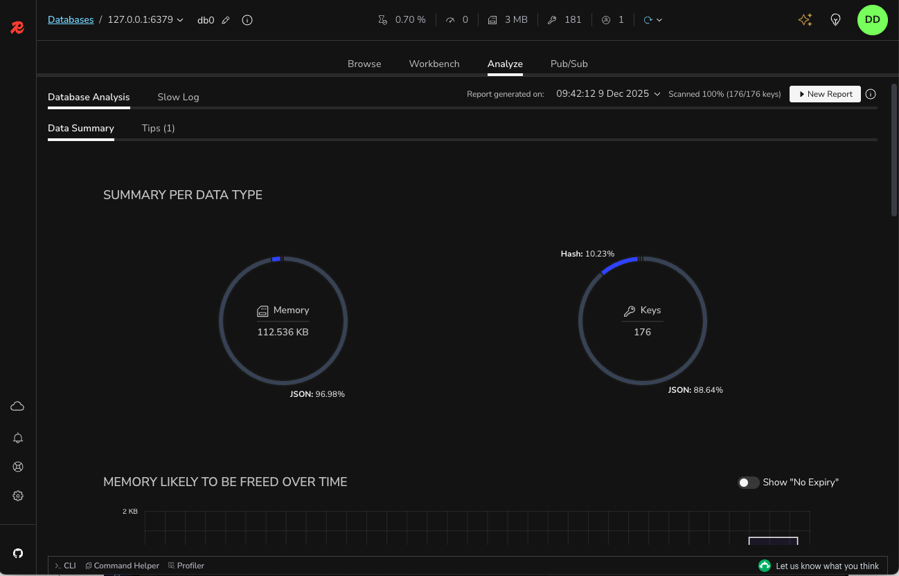

# Redis Insight Docker

Redis Insight Docker is Redis Insight in a container: the official GUI for Redis and Redis Stack. A redisinsight docker image gives you Browser, Workbench, CLI, Copilot, memory analysis, and a live profiler without installing a desktop build first.

This page is the handbook for that product. It covers Redis Insight as a desktop app and redis insight docker as the `redis/redisinsight` image. docker redis insight is the same job when the search box starts with the runtime.

Two neighbor trees in this pack are the same class: Another Redis Desktop Manager (Electron) and Tiny RDM (Wails, plus its own web image). Use them when you want a second Redis GUI next to Redis Insight.

## Overview

Redis Insight is a visual tool to design, develop, and optimize a Redis app. You query, analyse, and edit data. Built-in support covers Redis modules. Official builds target Redis OSS and Redis Cloud. Azure Managed Redis works too.

The Vue root on the official UI is [App.tsx](FILES/App.tsx). The API process starts in [main.ts](FILES/main.ts).

### Redis Insight Highlights

- Browse and filter keys. View values as JSON, Hex, ASCII, and other formats.
- CRUD for lists, hashes, strings, sets, sorted sets, and streams.
- CRUD for JSON, vector sets, and arrays.
- Interactive tutorials, including JSON query and vector search.
- Recommendations that update as you use the database.
- Profiler: every command, live.
- SlowLog from the Redis Slowlog command.
- Pub/Sub: subscribe and publish.
- Bulk delete from Browser or Tree filters.
- Workbench: command line with autocomplete and raw mode.
- Autocomplete for search, JSON, and time series.
- Visualizations of search indexes and results.
- Vector search index management.
- Your own visualization plugins.
- Works with Azure Managed Redis and Microsoft Entra ID.

Redis Insight Copilot is the in-app assistant for context queries and docs. Memory analysis scans keys and allocation. The real-time profiler is the same live command stream as Highlights above.

Browser UI is [BrowserPage.tsx](FILES/browser/BrowserPage.tsx). Workbench is [WorkbenchPage.tsx](FILES/workbench/WorkbenchPage.tsx).

## Feature

Tiny RDM, the Wails neighbor, lists the same class of work in a lighter shell.

- Super lightweight Webview2, no embedded Chromium
- Light and dark UI
- SSH Tunnel, SSL, Sentinel, Cluster, HTTP proxy, SOCKS5
- Visual CRUD for Lists, Hashes, Strings, Sets, Sorted Sets, Streams
- Several view formats and decode / decompress paths
- SCAN so millions of keys still list
- Command history, CLI, slow logs
- Segmented load for List / Hash / Set / ZSet
- Monaco editor
- Live command monitor
- Import / export data and connection profiles
- Publish / subscribe
- Custom encoder and decoder for values

Connection work on that tree is [connection_service.go](FILES/services/connection_service.go). Key browse and CLI sit in sibling Go services in the same folder.

## Feature Log

Another Redis Desktop Manager keeps a dated log. The useful bits for a Redis Insight user:

| When | What landed |
| --- | --- |
| 2026 | TimeSeries, Vector, ARRAY, test connection, connection groups |
| 2024 | Batch commands, hash field TTL, search connections, Stream groups, CLI args |
| 2022-2023 | Import/export keys, Stream search, Slow log, protobuf, memory analysis, readonly, monitor |
| 2020-2021 | Sentinel, ACL, Stream, tree view, SSL/TLS, cluster, dark mode, SSH |

Memory UI on that tree is [MemoryAnalysis.vue](FILES/analysis/MemoryAnalysis.vue). Key list is [KeyList.vue](FILES/components/KeyList.vue).

## Windows

Redis Insight ships a Windows desktop build and a Store listing. The neighbor Electron app builds a 64-bit or 32-bit package. Tiny RDM ships a Windows installer. Redis Insight Docker is the path that skips those installers: pull the image, publish a port, open the UI.

On Windows, keep Docker Desktop running if you use the image. A desktop MSI and a container can share the same Redis host. Do not bind the UI port to a public interface without a login in front.

## Linux

Snap, Flathub, and a desktop binary exist for Redis Insight. The Electron neighbor builds a Linux package. Tiny RDM is a Webview build. docker redis insight is the usual server path on Linux.

If a neighbor native build fails on fontconfig, that is a desktop compile issue. Redis Insight Docker does not need those headers.

## Mac

Redis Insight is on the Apple store and as a desktop download. The neighbors ship `.app` builds. Quarantine flags on a neighbor macOS app are an OS issue, not a Redis protocol issue.

## Docker Deployment

Tiny RDM also ships a web image. Redis Insight Docker is the official container: `redis/redisinsight`. redisinsight docker and redis insight docker are the same image under two search spellings.

Compose and entry scripts in this pack:

- Official image recipe: [Dockerfile](FILES/Dockerfile)
- Container start: [docker-entry.sh](FILES/docker-entry.sh)
- Neighbor compose: [docker-compose.yml](FILES/docker-compose.yml)
- API entry and nginx sit next to those files in FILES and docker/

### Using Docker Compose

A neighbor compose file looks like this (change the image if you want official Redis Insight instead of Tiny RDM):

    services:
      tinyrdm:
        image: ghcr.io/tiny-craft/tiny-rdm:latest
        container_name: tinyrdm
        restart: unless-stopped
        ports:
          - "8086:8086"
        environment:
          - ADMIN_USERNAME=admin
          - ADMIN_PASSWORD=tinyrdm
        volumes:
          - ./data:/app/tinyrdm

Start with `docker compose up -d`. Open the published port in a browser. Do not hard-code a machine-local URL in docs you share.

For official Redis Insight Docker, swap the image to `redis/redisinsight` and keep a volume for persisted connections.

### Using Docker Command

    docker run -d --name tinyrdm \
      -p 8086:8086 \
      -e ADMIN_USERNAME=admin \
      -e ADMIN_PASSWORD=tinyrdm \
      -v ./data:/app/tinyrdm \
      ghcr.io/tiny-craft/tiny-rdm:latest

Official Redis Insight uses the `redis/redisinsight` tag. Map the UI port the image documents. Neighbor entry is docker/entrypoint.sh.

### Environment Variables

| Variable | Role | Default |
| --- | --- | --- |
| `ADMIN_USERNAME` | Neighbor web login | unset |
| `ADMIN_PASSWORD` | Neighbor web login | unset |

Redis Insight Docker uses its own env for encryption keys, log level, and feature flags. Set those in compose, not in a public gist.

## Redis Insight API (only for Docker)

When Redis Insight runs from Docker, the HTTP API is on the published port under `/api`. Route table is [app.routes.ts](FILES/api/app.routes.ts). Nest module is app.module.ts. CLI module is [cli.module.ts](FILES/cli/cli.module.ts).

Open `/api/docs` on that port. Do not paste a loopback URL into this file.

## Azure Managed Redis

Redis Insight talks to Azure Managed Redis and the older Azure Cache for Redis name with Microsoft Entra ID. If the tenant requires admin consent, use the Azure setup notes in the official tree. Docker, custom ports, and reverse proxies have a separate Azure Docker note there.

## How to debug

If Redis Insight misbehaves, collect logs from the desktop process or from `docker logs` on the Redis Insight Docker container. Upstream wiki has a debug page. Profiler files in this pack are under `profiler/`. Neighbor live monitor is monitor_service.go.

## Redis Insight Plugins

You can add data visualizations. Plugin docs live in the official wiki. Keep plugin code out of core Browser and Workbench pages.

## Custom Viewer

The Electron neighbor lets you point a custom viewer at a value. Config is a small JSON block: command, args, whether the script needs execute permission. Without execute permission `x`, the viewer still runs if the host allows a non-exec interpreter. Redis Insight uses plugins for the same idea. Neighbor format UI is [FormatViewer.vue](FILES/components/FormatViewer.vue).

Keep custom viewers on your machine. Do not bake a secret decoder into a shared image layer.

## Start From Command Line (CLI)

The Electron neighbor accepts connection args: host, port, auth, cluster, SSH, sentinel, readonly, save. Redis Insight CLI is a tab, not those argv flags. Neighbor CLI tab is [CliTab.vue](FILES/components/CliTab.vue). Redis client helper is [redisClient.js](FILES/redisClient.js). Command table is commands.js in FILES.

### Parameter Description

| Group | Typical keys |
| --- | --- |
| Common | host, port, name, auth, readonly |
| SSH | ssh host, port, user, key, passphrase |
| CLUSTER | cluster flag, nat map |
| SSL | cert, key, ca |
| SENTINEL | sentinel host, master name |

New connection UI on that tree is [NewConnectionDialog.vue](FILES/connections/NewConnectionDialog.vue).

## FAQ

**How to connect to Redis Cluster on an internal network (Docker, LAN, AWS)?**

Use the NAT or cluster map the neighbor documents. Redis Insight Docker must reach the advertised cluster bus addresses from inside the container network, not from your laptop name.

**Do I need Username in the Redis configuration?**

Only if the server uses ACL (Redis 6+). Empty username is fine on old requirepass-only instances.

## Feedback

File features and bugs on the official Redis Insight tracker. Upvote existing feature issues before opening a duplicate.

Include the Redis version, the image tag, and whether Entra ID is on. A screenshot of Browser or Workbench helps more than a stack dump alone.

Do not attach production key dumps.

## Contributing

Official wiki: how to build and contribute. Neighbor trees accept PRs on their own orgs. Match the folder you touch: UI in `ui`, API in `api`, Electron neighbor in `src`, Wails neighbor in `backend` and `frontend`.

Pub/Sub on the Wails side is pubsub_service.go in services.

## Telemetry

Redis Insight has opt-in telemetry to improve DX. Data is anonymised. Turn it off in settings if you do not want it. Neighbors may ship their own analytics flags.

A Redis Insight Docker volume holds connections. Telemetry choice lives in that volume after the first run. Recreating the container without the volume resets the prompt.

## License

Redis Insight is SSPL. See LICENSE in FILES. The Electron neighbor and Tiny RDM ship their own licenses upstream. This pack keeps one LICENSE file only.

## Support

Official forum and Discord are listed on the Redis Insight repo. Neighbors have their own chats. For Redis Insight Docker, include the image tag and `docker logs` excerpt when you ask for help.

Say whether you run desktop Redis Insight or redisinsight docker. The Browser and Workbench screens look the same. The failure mode (missing volume, published port, Entra consent) is not.

## Download

Use the GET badge for this pack. Redis Insight also ships desktop builds for Windows, macOS, and Linux, plus the `redis/redisinsight` image. Community use is free. Pull the image, publish the UI port, and add a connection. Do not put a loopback URL in shared notes.

## Related Questions

**Can you explain Redis in detail?**

Redis is an in-memory data store. Keys hold strings, hashes, lists, sets, sorted sets, streams, JSON, and more. You talk to it with a client or a GUI. Redis Insight is that GUI. Redis Insight Docker is the same GUI in a container.

**Is RedisInsight free for commercial use?**

Redis Insight is free to download and run. SSPL covers the official source. Read the license that shipped with the image or desktop build you use. Neighbors have their own terms.

**Is Redis an Israeli company?**

Redis the software started as an open source project. Redis the company behind Redis Insight is a commercial vendor with offices in more than one country. Product docs and legal pages on redis.io are the source for corporate facts, not this handbook.

**How to create a Redis client?**

For a GUI, use Redis Insight or redis insight docker, add host, port, and ACL user if needed. For code, pick a language client and the same host. The neighbor dialog is NewConnectionDialog.vue. Official Browser is BrowserPage.tsx.

## Related Search Terms

Redis Insight Docker, Redis Insight, redisinsight docker, redis insight docker, docker redis insight, redis, redis-gui, redis-client, redis-desktop, docker, electron, vue, go, database-gui, redis-cluster, typescript
